# SAVIS Architecture

This document describes the current architecture of SAVIS using C4-style
system, container, component, and dynamic views.

It focuses on ownership, dependencies, runtime behavior, persistence, and
delivery. Reviewed against the repository source and deployment definitions on
2026-10-31. This describes implemented behavior; external notification infrastructure
and future capabilities are identified separately.

Setup instructions and feature details belong in the
[root README](../README.md) and module documentation.

## Navigation

- [Scope](#scope)
- [Architectural Drivers](#architectural-drivers)
- [Architecture Used in SAVIS](#architecture-used-in-savis)
- [System Context](#system-context)
- [Container View](#container-view)
- [Production Topology](#production-topology)
- [API Components](#api-components)
- [Executor Components](#executor-components)
- [Admin Components](#admin-components)
- [Runtime Flows](#runtime-flows)
- [Data Ownership](#data-ownership)
- [Monetary Policy](#monetary-policy)
- [Messaging](#messaging)
- [Operational Characteristics](#operational-characteristics)
- [Delivery Architecture](#delivery-architecture)
- [Verification and Source Map](#verification-and-source-map)
- [Architectural Rules](#architectural-rules)
- [Known Constraints](#known-constraints)

## Scope

SAVIS is the internal back-office system for SavouretPlus. It currently owns:

- material resources and their associations with components and supplier offers;
- technical BOMs, components, activities, yields, and costs;
- provider offer acquisition and review;
- global activity rates;
- sellable catalog products and configuration rules;
- product cost and margin analysis;
- publication of a limited customer-facing catalog projection;
- normalized local orders entered by administrators or imported manually from
  the Supabase web inbox;
- commercial quotations, accepted-quotation conversion to orders, and invoices;
- quotation and invoice PDF generation and order production requirement reports.

The public SavouretPlus application and Supabase commerce tables are outside
the SAVIS system boundary. SAVIS publishes catalog data to Supabase but does
not use Supabase as its business database.

Inventory, purchasing, catering operations, and decoration operations are not
yet SAVIS business slices.

### Diagram Conventions

The diagrams use Mermaid for rendering in GitHub. C4 Level 4 code diagrams are
intentionally omitted because package and class details are better represented
by source code and automated module tests.

## Architectural Drivers

1. **Clear ownership**

   Java owns business state. Python owns acquisition execution and provider
   state. Supabase owns only the public projection and customer submissions.

2. **Asynchronous provider access**

   Scraping is slow, externally constrained, and failure-prone. HTTP handlers
   and RabbitMQ callbacks persist and enqueue work instead of performing it.

3. **Persistent browser identity**

   Google Chrome runs outside Docker and Celery so its profile, cookies, local
   storage, and browser identity survive task and container restarts.

4. **Explicit module boundaries**

   Business slices communicate through public APIs and ports. Catalog never
   accesses BOM entities or repositories directly.

5. **Independent schema evolution**

   The API, Executor, and Supabase each own their migrations and persistence
   lifecycle.

6. **Operationally verifiable releases**

   Production uses immutable image digests, ordered migrations, dependency
   health checks, and a checksummed release package.

## Architecture Used in SAVIS

SAVIS is built as a modular monolith plus a separate acquisition executor.
The API keeps business modules in one deployable Spring Boot application, while
the Executor isolates provider access, browser automation, and Celery work.

The main architectural patterns used are:

| Pattern                                      | Where it appears                                                                                                                                             | Purpose                                                                                                                                                                               |
| -------------------------------------------- | ------------------------------------------------------------------------------------------------------------------------------------------------------------ | ------------------------------------------------------------------------------------------------------------------------------------------------------------------------------------- |
| Modular monolith                             | SAVIS API modules: Resource, BOM, Supply, Catalog, Quotation, Order, Invoice, Common                                                                         | Keep business slices independently understandable while sharing one JVM, one deployment unit, and in-process module calls.                                                            |
| Spring Modulith module verification          | `SavisApiModularityTests` and named interfaces                                                                                                               | Enforce allowed module dependencies and document the module graph.                                                                                                                    |
| Hexagonal architecture / ports and adapters  | API use cases depend on repository, pricing, publication, and messaging ports; Executor use cases depend on repository, queue, publisher, and provider ports | Keep domain/use-case code independent from HTTP, JPA, RabbitMQ, Supabase, provider HTML, and browser automation details.                                                              |
| Domain-driven tactical patterns              | Aggregates such as BOM and catalog Product; value objects such as Money, Quantity, Unit                                                                      | Put business invariants and calculations close to the model that owns them.                                                                                                           |
| Repository pattern                           | JPA repositories in the API and SQLAlchemy repositories in the Executor                                                                                      | Hide persistence mechanics behind module-specific persistence adapters.                                                                                                               |
| Application service / use-case orchestration | `BomService`, `OfferService`, catalog services, Executor use cases                                                                                           | Coordinate validation, persistence, pricing, messaging, and external ports without pushing workflow into controllers.                                                                 |
| Adapter pattern                              | Web controllers, RabbitMQ listeners/publishers, Supabase adapter, provider adapters                                                                          | Isolate protocol-specific and vendor-specific code at the edges.                                                                                                                      |
| Facade / public module API                   | `ResourceCatalogApi`, `BomPricingApi`, `BomRequirementsApi`, `SupplyApi`, `CatalogOrderingApi`, `QuotationOrderApi`, `OrderInvoicingApi`                     | Allow one module to consume another module's capability without depending on its entities or repositories.                                                                            |
| Event-driven integration                     | RabbitMQ offer request, result, and invalidation messages                                                                                                    | Decouple the API from slower provider acquisition and allow asynchronous processing.                                                                                                  |
| Outbox pattern                               | Spring Modulith event publication table `event_publication` for API events externalized to RabbitMQ                                                          | Retained API event infrastructure; current BOM saves and pricing do not publish acquisition requests. This does not provide an Executor outbox.                                       |
| Declarative event externalization            | `@Externalized` on `ComponentNeededEvent` and Modulith AMQP externalization                                                                                  | Declare which application events leave the module boundary and map retained domain events to the compatible RabbitMQ contract in one place; no current BOM workflow emits this event. |
| Message contract mapping                     | `ComponentNeededEvent` maps to the RabbitMQ payload `{content,type}`                                                                                         | Preserve external wire compatibility while allowing the Java domain event to keep domain-oriented names.                                                                              |
| Durable broker topology                      | Durable RabbitMQ queues, direct exchange, and queue bindings                                                                                                 | Keep broker routes stable across restarts and avoid coupling publishers directly to queue declaration details.                                                                        |
| Task queue / worker pattern                  | Celery tasks and RabbitMQ delivery in the Executor                                                                                                           | Run slow browser/provider operations outside request and subscriber callbacks.                                                                                                        |
| Scheduled jobs                               | Celery Beat executor workflows                                                                                                                               | Run refresh and cleanup workflows on explicit schedules.                                                                                                                              |
| Circuit breaker / provider protection        | Executor provider access policy cooldowns                                                                                                                    | Reduce repeated requests when a provider blocks or becomes unhealthy.                                                                                                                 |
| Retry with backoff and stale cleanup         | Celery retry policy, hard task limits, and scheduled stale task cleanup                                                                                      | Recover from transient failures while making stuck work visible and terminal.                                                                                                         |
| Read model / projection                      | API Supply offer projection and Supabase published catalog projection                                                                                        | Store query-friendly views owned by the consumer boundary rather than sharing internal aggregates.                                                                                    |
| Health check and readiness gates             | API, Executor, RabbitMQ, PostgreSQL, Chrome relay, deployment script                                                                                         | Promote releases only after dependencies and application components are operational.                                                                                                  |

These patterns are intentionally not applied uniformly everywhere. The system
retains an event/outbox adapter for compatible acquisition requests and uses
direct in-process APIs for synchronous module calls such as catalog pricing.
Executor result publication and Supabase REST calls do not participate in an
atomic transaction with local PostgreSQL writes.

## System Context

### C4 Level 1

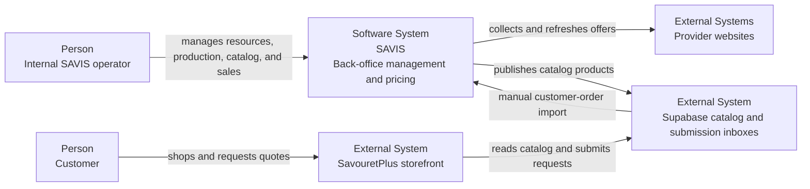

### System Boundaries

| System            | Owns                                                                | Does not own                                     |
| ----------------- | ------------------------------------------------------------------- | ------------------------------------------------ |
| SAVIS             | Internal business state, provider acquisition, pricing, publication | Public storefront sessions and customer identity |
| Provider websites | Product pages, prices, availability, anti-automation behavior       | SAVIS offer review state                         |
| Supabase          | Public projection, customer orders, quote requests, RLS             | BOMs, internal costs, provider tasks             |
| SavouretPlus      | Customer-facing experience                                          | SAVIS business rules                             |

Provider-specific HTML and navigation behavior must remain inside Executor
adapters and must not leak into Java domain models.

## Container View

### C4 Level 2

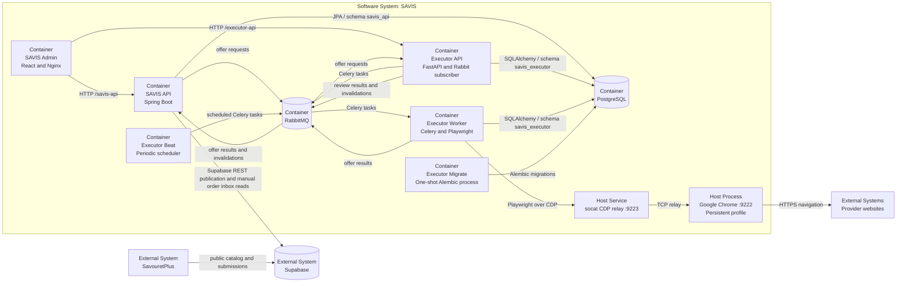

### Container Responsibilities

| Container or process | Responsibility                                                 | State                   |
| -------------------- | -------------------------------------------------------------- | ----------------------- |
| `frontend_admin`     | Serves the SPA and proxies API traffic                         | Browser state only      |
| `backend_api`        | Runs resources, costing, catalog, quotations, orders, invoices | `savis_api` schema      |
| `executor_api`       | Exposes offers/tasks and subscribes to offer requests          | `savis_executor` schema |
| `executor_worker`    | Executes slow provider collection and refresh                  | `savis_executor` schema |
| `executor_beat`      | Schedules due refreshes and stale-task cleanup                 | Celery schedule state   |
| `executor_migrate`   | Applies forward-only Executor migrations                       | Alembic version table   |
| `postgres`           | Hosts independently owned API and Executor schemas             | Docker volume           |
| `rabbitmq`           | Carries integration messages and Celery tasks                  | Durable broker data     |
| Google Chrome        | Maintains the provider-facing browser identity                 | Host profile directory  |
| CDP relay            | Makes loopback Chrome CDP reachable from Docker                | None                    |

## Production Topology

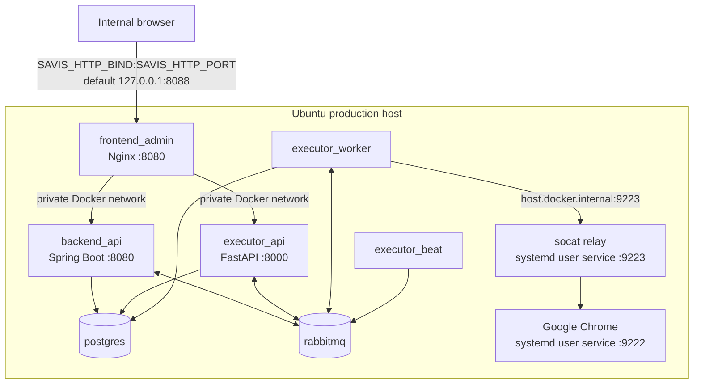

Only the Admin port is published by `docker-compose.prod.yml`. API, Executor,
PostgreSQL, and RabbitMQ remain on the private backend network.

The Admin Nginx container is the production entry point:

- `/` serves the React single-page application;
- `/savis-api/*` proxies to `backend_api:8080/api/*`;
- `/executor-api/*` proxies to `executor_api:8000/api/*`;
- `/health` provides a container health endpoint.

Chrome and its relay are user-level `systemd` services owned by the graphical
desktop user. They deliberately outlive Docker deployments.

## API Components

### C4 Level 3

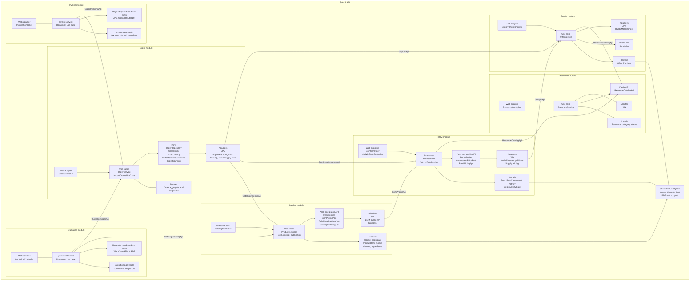

### Module Boundaries

- BOM consumes offer prices through `SupplyApi`.
- Each BOM component references Resource by public UUID through `ResourceCatalogApi`;
  BOM never accesses Resource persistence. Resource deactivation does not remove
  historical BOM lines. Component names remain display/acquisition snapshots;
  BOM valuation retrieves available offers by resource UUID in a batch. Explicit
  selections must belong to the component resource or produce a blocking diagnostic.
- Flyway V12 shares one Resource UUID per normalized legacy component name
  (trimmed, whitespace collapsed, case ignored), after checking unit dimensions.
  Existing Resource ambiguity or incompatible units abort atomically. BOM quantity,
  selected offer, name snapshot and pricing inputs remain unchanged.
- Catalog consumes BOM cost and yield through `BomPricingApi`.
- Order consumes validated product snapshots through `CatalogOrderingApi` when
  an administrator creates an order, and consumes public Catalog, BOM, and
  Supply contracts when generating production requirements.
- Quotation consumes `CatalogOrderingApi` directly to capture validated commercial
  snapshots, then `QuotationOrderApi` to convert an accepted quotation.
- Invoice consumes `OrderInvoicingApi` to copy a locked eligible order snapshot;
  it does not depend on Order entities or query Catalog again.
- Catalog stores BOM UUID values, not JPA relationships to BOM entities.
- `common` contains shared value objects and PDF font support, not workflow orchestration.
- HTTP, JPA, RabbitMQ, and Supabase dependencies remain in adapters.

`SavisApiModularityTests` uses Spring Modulith to verify module dependencies and
generate module documentation snippets.

### Pricing Boundary

```text
Catalog use case
  -> BomPricingPort
  -> BomPricingAdapter
  -> BomPricingApi
  -> BomService
  -> ComponentPricePort
  -> ComponentPriceAdapter
  -> SupplyApi
```

This path keeps Catalog independent from BOM and Supply persistence while still
allowing synchronous in-process pricing.

## Executor Components

### C4 Level 3

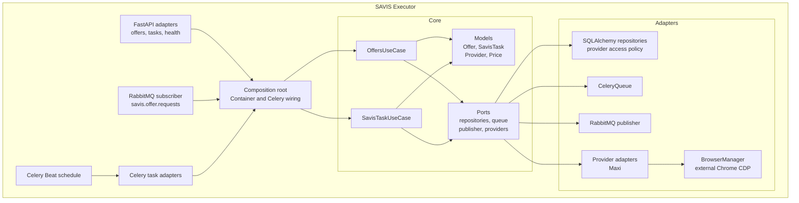

### Execution Rules

- Core models and use cases are provider-neutral.
- API routes and subscriber callbacks validate, persist, and enqueue.
- The worker performs browser navigation.
- One worker process with concurrency `1` controls the shared Chrome profile.
- `BrowserManager` opens one page per operation and disconnects without
  terminating Chrome.
- Provider adapters own selectors, parsing, block detection, and normalized
  offer conversion.
- `ReportingTask` records final Celery failures in SAVIS task persistence.

### Failure Classification

| Failure                        | Celery behavior                                             |
| ------------------------------ | ----------------------------------------------------------- |
| Unexpected transient exception | Retry with backoff, maximum 3 retries                       |
| Provider block or open circuit | Fail without immediate retry                                |
| Chrome CDP unavailable         | Fail without immediate retry                                |
| 30-minute task limit reached   | Worker terminates the task; stale cleanup provides recovery |

Immediate retries are avoided when the provider or browser state cannot improve
within the same task attempt.

## Admin Components

### C4 Level 3

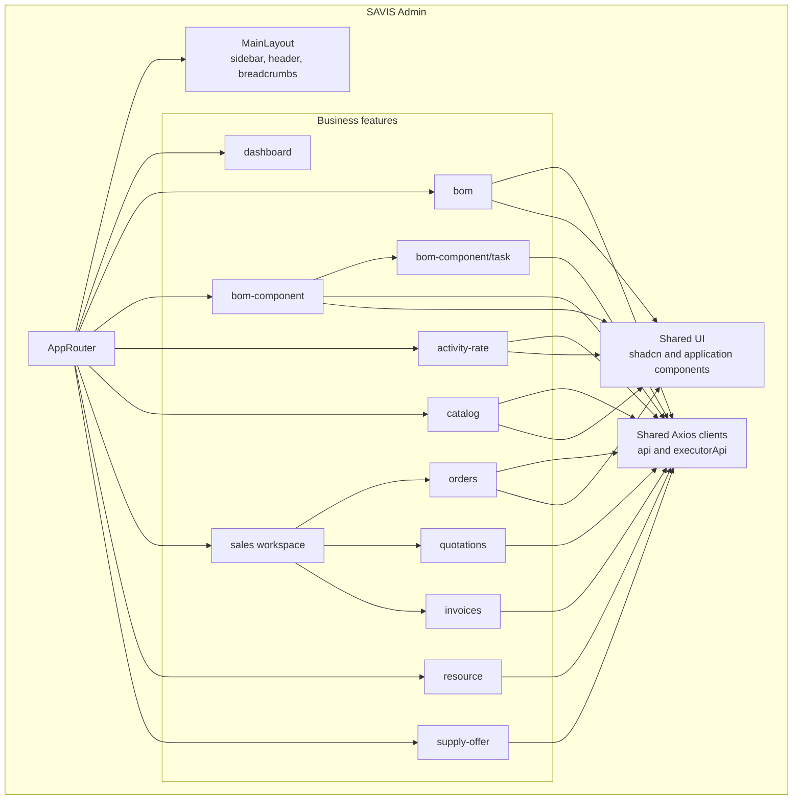

| Client        | Default production path | Target         |
| ------------- | ----------------------- | -------------- |
| `api`         | `/savis-api`            | SAVIS API      |
| `executorApi` | `/executor-api`         | SAVIS Executor |

The dashboard currently demonstrates the application shell with static data.
It is not yet an operational read model.

### State and Navigation

- `src/app` owns routing, providers and layout; `src/features` owns API calls,
  hooks, models, components and pages; `src/shared` owns Axios clients and UI primitives.
- TanStack Query owns server state and feature query invalidation. Supported
  list filters, sorting, pagination and selected details are URL state.
- Resource, Supply, Executor offer and task lists use backend pagination.
  BOM and Catalog consultation filter and paginate the loaded collection.
- BOM and product creation drafts use `localStorage`; new order and quotation
  drafts use tab-local `sessionStorage`. These are unsaved browser drafts,
  not business persistence.
- `/sales/{quotations,orders,invoices}` groups sales lists. Editors/details use
  `/quotations/*`, `/orders/*`, and `/invoices/*`; legacy list URLs redirect.
- `VITE_API_URL` and `VITE_EXECUTOR_API_URL` override proxy roots at build time.
  Vite uses `SAVIS_API_PROXY_TARGET` and `EXECUTOR_API_PROXY_TARGET` for development.
  Runtime Nginx environment changes do not reconfigure the built bundle.
- UI text is French. Backend prices are authoritative; frontend totals are previews.

### Procurement and Catalog Consultation

Executor review at `/offers`, API Supply consultation at `/supply/offers`, and
acquisition task history at `/offers/tasks` represent separate models. Review
starts with `NEW` offers and uses exact search-term facets; task filtering supports
status and type. The Supply page resolves its Resource labels with a bounded
`GET /api/resources/batch?ids=...` read (up to 100 distinct UUIDs), avoiding one
request per row. Unassociated and unresolved resources are displayed separately.

Catalog consultation uses the loaded product list and cached unpriced BOM list.
A dedicated `/catalog-products/:productId/analysis` route invokes configuration
and worst-case analysis. TanStack Query keys distinguish configurations and are
invalidated with the product query prefix. Diagnostic `bomId` identifies the
requested BOM; `missingBomIds` may include existing BOMs with incomplete costs.
The current analysis exposes aggregate costs and diagnostics, not per-BOM cost
contributions.

## Runtime Flows

### Activity Rate Configuration

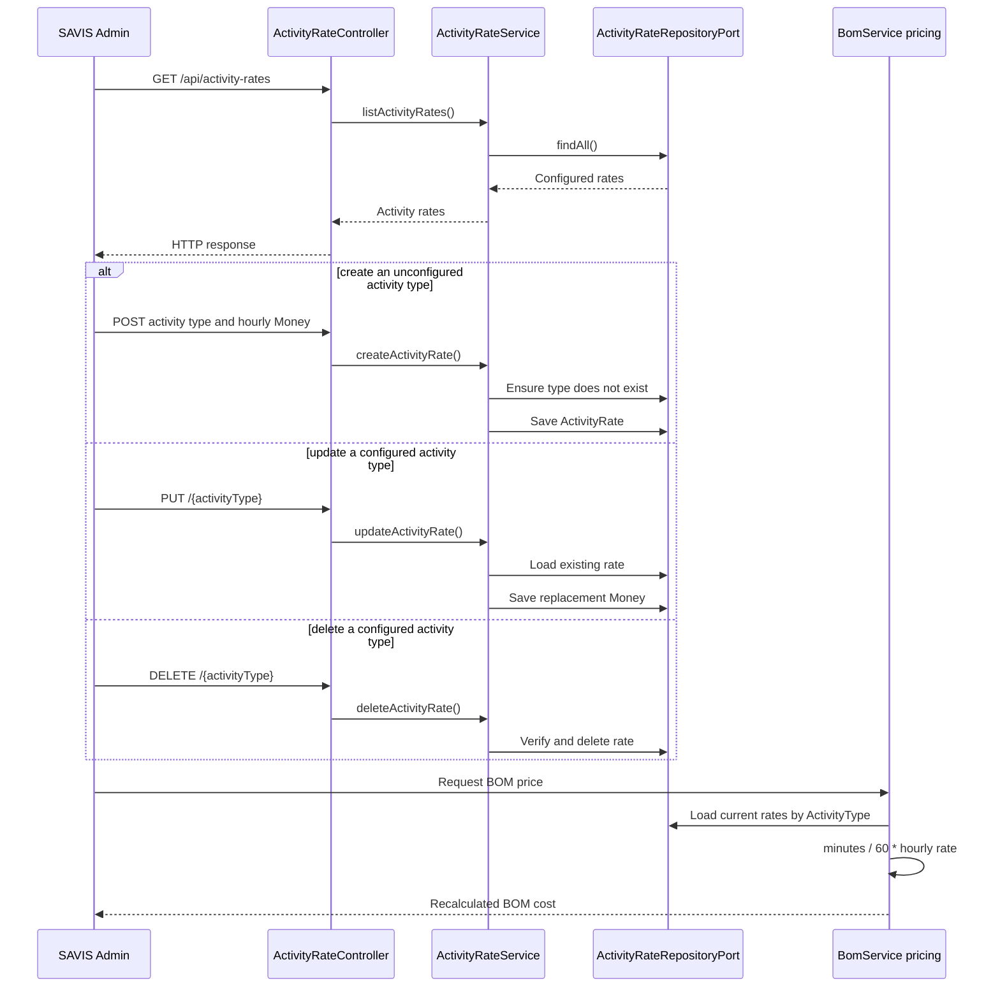

Activities store only their type and duration. Rates are global and are read
when a BOM is priced, so a configuration change affects subsequent
calculations without modifying existing BOM activities. A missing rate
produces a missing activity line with a blocking diagnostic. An explicitly
configured zero rate is known. COOK semantics remain unchanged and may represent
elapsed oven time; separating equipment from labor belongs to the future phase.

### Manual Offer Retrieval

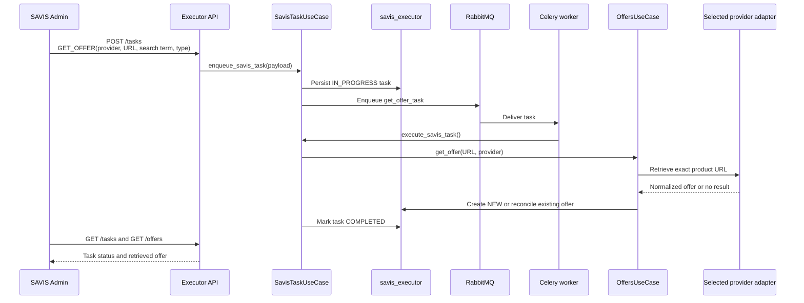

Manual retrieval targets one exact provider URL and does not run the
all-provider coverage check used by automatic `GET_OFFERS` collection. Queueing
failure marks the persisted task failed; execution failures follow the retry
flow described below.

Manual retrieval is the preferred acquisition path when the operator knows the
exact provider product URL. It is more precise and avoids broad provider search
results.

### BOM Save and Cost Consultation

BOM creation, replacement and component changes validate Resource UUIDs, status
and units, then persist the aggregate and resource name snapshots. They publish
no acquisition event and enqueue no Executor task. Resource creation only
persists business data; association validates an existing reference.

Admin posts the BOM to `POST /api/boms`, then reloads `GET /api/boms/{id}`.
Cost consultation batch-reads existing Supply offers by Resource UUID, retaining
selected offers or choosing the cheapest compatible existing offer. Missing
prices produce diagnostics and do not block saving.

Explicit acquisition via Executor `POST /api/tasks` and independent scheduled
refresh remain available. The RabbitMQ request contract is retained for
compatibility; BOM saves no longer produce requests.

### Review, Invalidate, and Delete an Offer

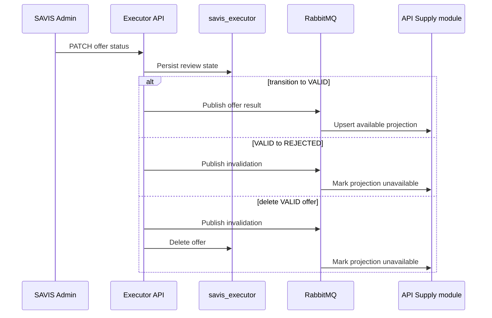

The Executor owns review history and refresh settings. The API stores a separate supplier-offer projection with availability and
Resource associations; invalidation retains the offer as unavailable. Supply
also supports manually created offers independent of Executor acquisition.

### Scheduled Refresh and Provider Protection

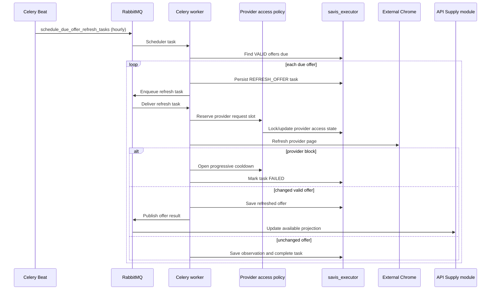

Navigation starts are spaced between 1 and 10 minutes by default. Consecutive
blocks open the circuit for 15 minutes, 1 hour, 6 hours, then 24 hours. After a
cooldown, one recovery probe is reserved.

Celery Beat also marks tasks still `IN_PROGRESS` after two hours as failed. The
cleanup runs every 15 minutes.

### Executor Retry and Scheduling

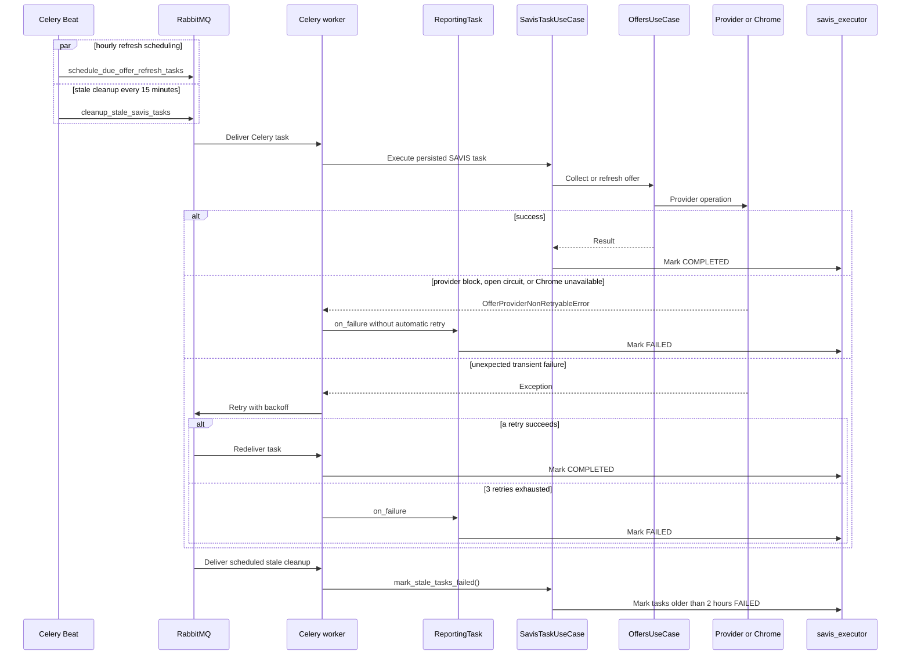

Celery enforces a 30-minute hard task limit, worker prefetch `1`, concurrency
`1`, and at most 10 tasks per child process. Retry policy and stale cleanup are
complementary: retries handle transient execution failures, while cleanup
recovers persisted tasks whose worker never reported a terminal state.

### Catalog Product Management

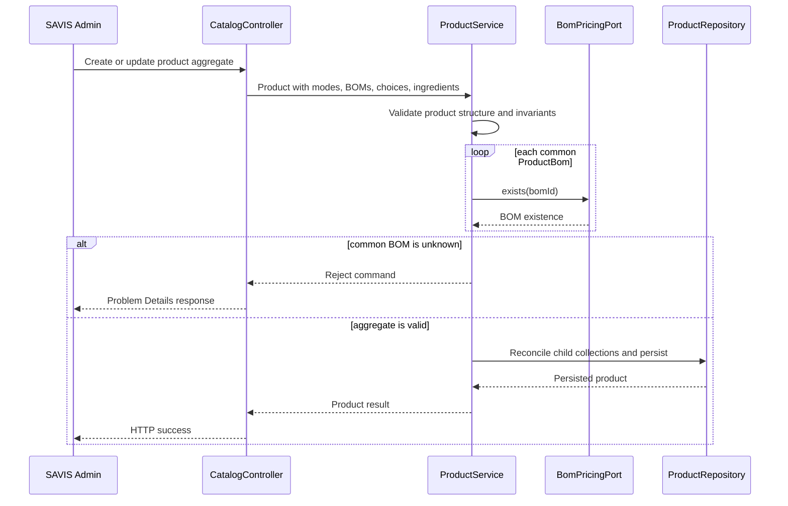

Common `ProductBom` references must resolve when a product is saved. Choice and
ingredient BOM references remain optional; unresolved optional references make
pricing analysis incomplete rather than blocking product management.

Each product has a required `ProductCategory` and an optional
`ProductSubcategory`. Each subcategory carries its parent category in the domain,
so incompatible assignments are rejected before persistence. The database
stores the enum name in a nullable text column without enumerating allowed
values in a SQL constraint; extending the code list does not require a schema
migration.

### Catalog Pricing

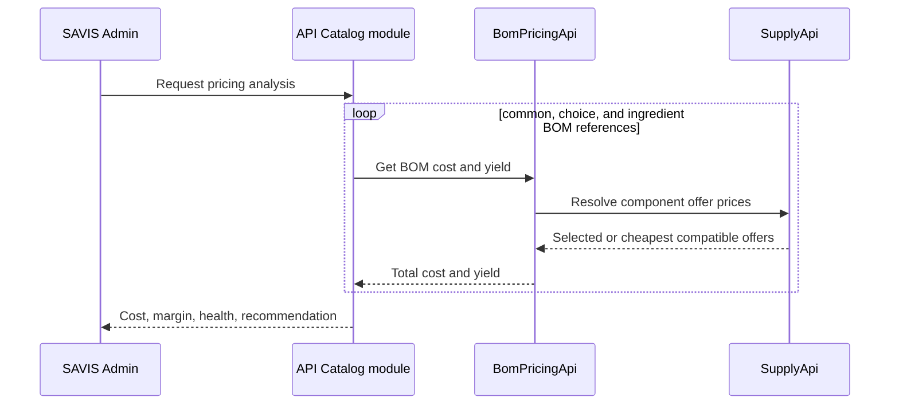

Pricing recommendations are advisory and never mutate sale prices. Missing or
non-calculable BOM references and internal missing BOM cost lines produce an
`INCOMPLETE` result. The public BOM valuation includes component/activity lines,
known subtotals, source diagnostics and nullable complete total. Catalog maps
that DTO through its own port; no internal BOM model crosses the boundary.
Incomplete analyses expose a known subtotal but no total/unit cost, margin or
recommendation. Unexpected technical failures propagate instead of becoming
missing-BOM diagnostics.

The BOM list (`GET /api/boms`) returns composition data without invoking pricing,
supplier prices or activity rates; `price` and `costing` remain null. Admin list
cards contain no cost information. Its unpriced list cache (`["boms"]`) is fresh
for 60 seconds and invalidated after saves/clones/deletions. The detail route
loads `GET /api/boms/{id}` on entry and revalidates after a successful save,
including the saved valuation for “Analyse des coûts”. Saving stays on detail;
creation replaces the creation route with the new composition's detail route. The explicit `GET /api/boms/{id}/price` endpoint and the public
`BomPricingApi` used by Catalog are preserved. Multi-BOM list pricing was removed;
per-BOM component batching and supplier lookup caching remain used by detail and
Catalog. The analysis shows grouped component/activity lines and diagnostics;
identifiers and timestamps remain in secondary provenance disclosures. Backend `BigDecimal` subtotals are summed
before display rounding. Admin formats each amount independently and preserves
the received total, with a precision note explaining possible cent differences.
This presentation does not change cost formulas, rate ownership or COOK semantics.

Selected supplier references retain the existing deterministic policy: a resolved
unavailable offer uses its last observed price with a warning; only an unresolved
selected UUID falls back to the cheapest usable compatible offer. No RabbitMQ or
Executor contract changes are involved. Calculation responses include the prices
and rates used but are not historical persisted snapshots.

### Catalog Publication

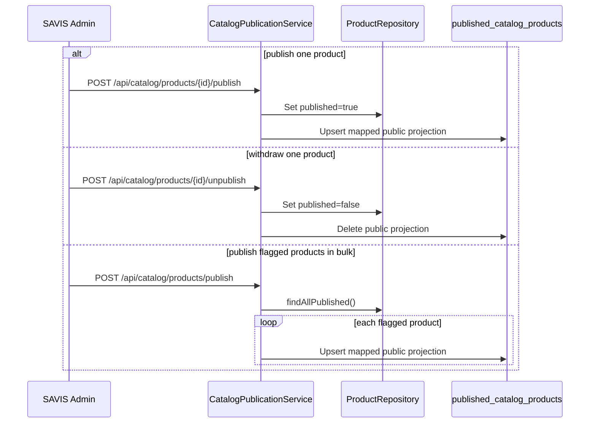

Publication requires `SUPABASE_ENABLED`, a URL and the backend service-role key.
There is no catalog publication scheduler. Saving a product and publishing it are
separate operations. Bulk publication does not remove stale projections of
unpublished or deleted products; explicit withdrawal handles a single product.

The projection carries public identity, category/subcategory codes, commercial
nature (`GOODS` or `SERVICE`), purchase modes, configuration options and commercial
prices in CAD cents. It excludes internal BOM references, costs, target margins,
diagnostics and recommendations. Services can be sold without a BOM.

Local publication flags and remote REST writes are not a distributed transaction.
A local rollback cannot undo an already successful remote write, and bulk
publication may partially succeed before a later failure. Re-publication or
explicit withdrawal is the reconciliation mechanism.

### Manual Supabase Order Import

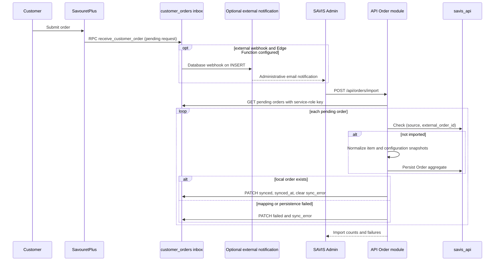

Supabase is the raw public inbox, while `savis_api.orders` is the normalized
business model. The import is manual only: SAVIS has no webhook endpoint,
scheduler, polling loop, or Celery task for orders. Prices are immutable
snapshots from the submitted payload and are never looked up again in Catalog.
The raw Supabase row is retained as JSONB for audit.

The database uniqueness constraint on `(source, external_order_id)` makes the
flow idempotent. A pending Supabase row whose local order already exists is
acknowledged as synced. This also repairs the case where local commit succeeded
but the previous Supabase acknowledgement failed. Mapping/persistence failures
are marked `failed`; acknowledgement failures after a successful local save are
reported separately and leave the source eligible for acknowledgement repair.

The webhook, Edge Function and email provider described in the
[Supabase README](../supabase/README.md) are external infrastructure instructions;
the repository does not ship that notification implementation.

### Administrative Order Entry

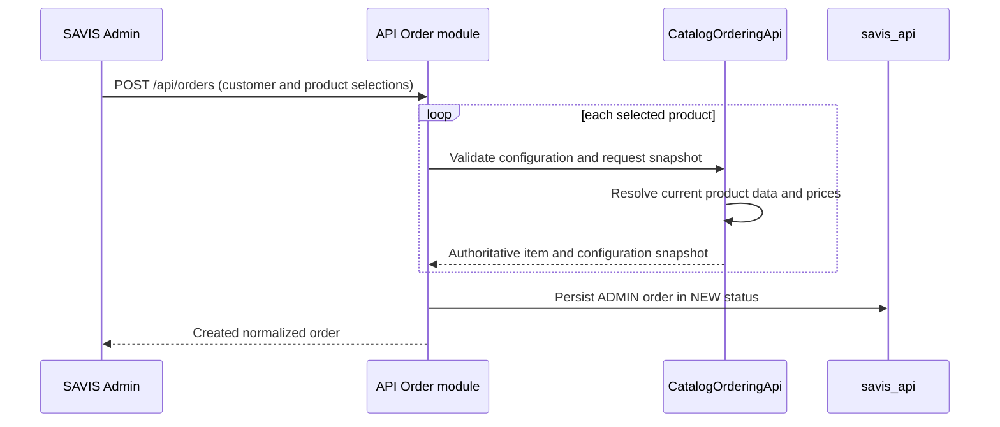

The browser submits catalog identifiers, quantities, and configuration codes;
it cannot submit product names or prices. Catalog validates the current product
rules and calculates prices before Order captures immutable snapshots. This
keeps subsequent order processing independent from later catalog changes.
An `ADMIN` order at `NEW` can be replaced and repriced from the current Catalog.
A web order at `NEW` permits customer/contact/note corrections only. Commercial
lines are frozen after `NEW`. The lifecycle includes `ACCEPTED`,
`IN_PREPARATION`, `READY`, `COMPLETED`, `REJECTED` and `CANCELLED`.
The administrative product dropdown queries a bounded, debounced Catalog
search instead of loading the complete product collection.

### Order Production Requirement Report

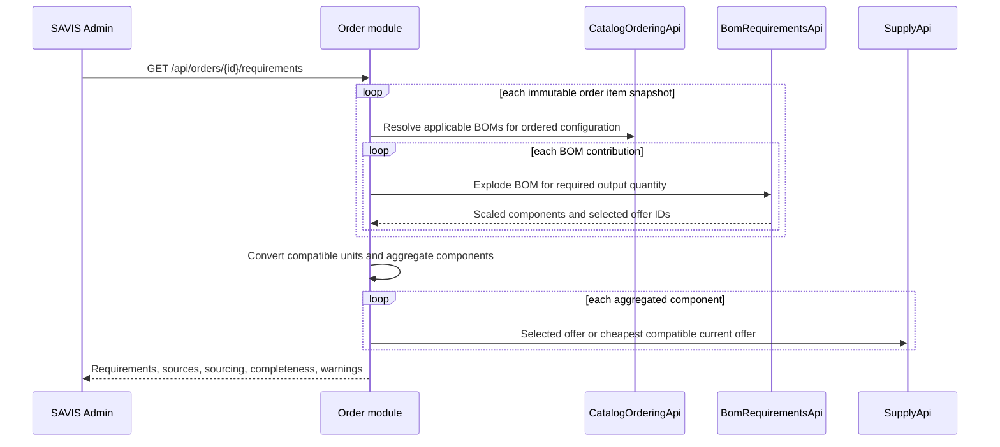

The report reads current Catalog, BOM, and Supply data without modifying the
order or its immutable commercial snapshots. `order` depends only on the public
APIs of those modules through local ports and adapters. Missing supplier offers
do not make production quantities incomplete. Inventory-aware missing and
purchase quantities remain intentionally unset until an inventory module owns
on-hand stock.

### Commercial Quotation and Order Conversion

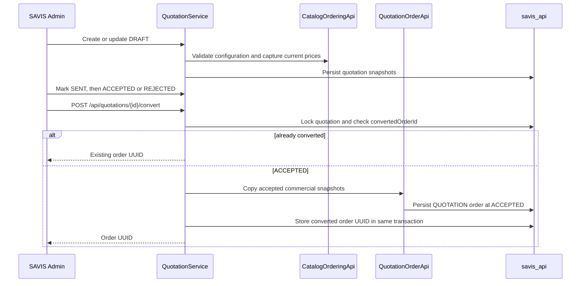

Only draft quotations are editable. Conversion does not consult current Catalog
prices. The Order public API also checks `(source, external_order_id)` with the
quotation UUID to avoid duplicate conversion. Status `SENT` records a business
transition; it does not send an email.

### Invoice Creation and Documents

`POST /api/invoices` takes an order UUID. `OrderInvoicingApi` locks and snapshots
an order at `ACCEPTED`, `IN_PREPARATION`, `READY` or `COMPLETED`. Invoice creates
one `DRAFT` per source order, guarded by a database unique constraint, and returns
the existing invoice for subsequent eligible requests. It copies the commercial
lines and adjustments without consulting Catalog and initializes TPS/TVQ to zero.

Draft updates can change customer details, notes, discount, delivery fee and
explicit tax amounts; product lines remain copied snapshots. Issuing assigns the
final invoice number and moves to `ISSUED`; cancellation moves a draft or issued
invoice to `CANCELLED` without creating a credit note. No payment workflow or
automatic tax-rate calculation is implemented.

Quotation and Invoice expose `GET /api/{quotations|invoices}/{id}/pdf` through
dedicated document use cases and renderer ports. OpenHTMLtoPDF adapters render
persisted commercial snapshots using repository templates and bundled fonts.
Rendering does not reprice the document; Invoice PDF generation requires a
previously issued invoice, including one subsequently cancelled. Documents are generated on demand, not stored in Supabase.

### Public Event Quote Reception

`public.submit_quote_request(payload jsonb)` stores raw event requests in
Supabase `quote_requests`. It validates published offering snapshots and allows
mixed catering/decoration requests. A private `quote_request_receipts` ledger
uses `(scope, request_id)` and a canonical JSONB hash for transactional
idempotency: an identical retry returns the existing UUID; a changed payload
with the same key fails.

Public roles execute the `SECURITY DEFINER` RPC with an empty `search_path`;
they cannot read/write the inbox or private ledger directly. This is separate
from SAVIS commercial `quotation`: no API mapper, import endpoint or Admin
workflow consumes `quote_requests`. See the
[RPC contract and coordinated rollout](integration/mixed-event-quote-request-rpc.md).

## Data Ownership

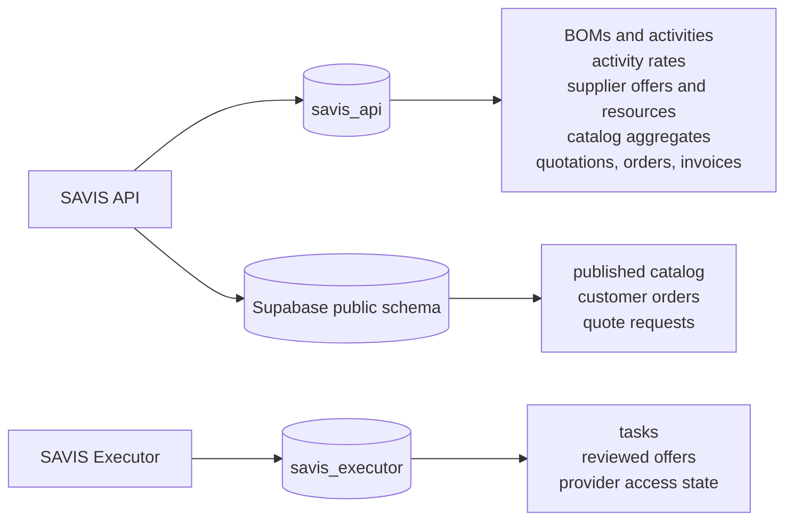

| Owner          | Migration mechanism                                      | Runtime policy                      |
| -------------- | -------------------------------------------------------- | ----------------------------------- |
| SAVIS API      | Flyway under `savis-api/src/main/resources/db/migration` | Hibernate `ddl-auto=validate`       |
| SAVIS Executor | Alembic under `savis-executor/alembic/versions`          | Explicit `executor_migrate` process |
| Supabase       | SQL under `supabase/migrations`                          | Applied by Supabase CLI             |

The current API migration chain runs from V1 to V13: commerce tables were added
in V5 (orders), V8 (quotations) and V9 (invoices); V11–V13 introduce resources and
link BOM components and Supply offers to them. Invoice retains a database foreign
key to the source order public UUID; this does not permit cross-module repository
access. Executor has an initial schema and a follow-up active-refresh uniqueness
migration. Supabase has its own timestamped catalog/inbox/RPC migrations.

API tests use H2 in PostgreSQL compatibility mode with
`ddl-auto=create-drop`; Flyway is disabled in that test profile.

Executor downgrades are intentionally unsupported. Production migrations are
forward-only.

### Resource Associations

Resource owns material identity, category, active status and optional reference
unit. Names are not unique business identifiers. BOM components reference its
UUID and retain name snapshots; deactivation preserves historical compositions.
Resource filtering and whitelisted sorting occur before server pagination with
stable UUID tie-breaks.

Supply owns the offer-to-Resource association. Operators can create a manual offer
or associate an acquired offer, subject to active-resource and compatible-unit
validation. Incoming Executor messages contain no Resource UUID; persistence
preserves an existing operator association during acquisition updates. New
unassociated discoveries require explicit operator association for resource-based
BOM costing. No Resource synchronization is added to Executor.

### Cross-Boundary Identifiers

- Public UUIDs cross HTTP, messaging, and module boundaries.
- Internal database identity columns remain private to their owning schema.
- Catalog BOM references are UUID values without database foreign keys to BOM
  tables.
- Supabase order UUIDs are stored as `external_order_id`; SAVIS public order
  UUIDs remain the HTTP identifiers.
- Executor and API offer records form separate models connected by published
  identifiers, not shared tables.

## Monetary Policy

Supply, BOM and Catalog use `Money(BigDecimal, currency)` in dollars. Costs retain
intermediate precision; entered prices and hourly rates must be exactly
representable at the cent. Mixed-currency arithmetic is rejected and there is no
currency conversion.

Quotation, Order and Invoice use integer CAD cents. Catalog validates CAD and
converts at the commercial snapshot/publication boundary with `HALF_UP` and exact
integer overflow checks. Line and aggregate arithmetic also rejects overflow.
Quotation and Order total lines minus discount plus delivery; Invoice additionally
includes explicit TPS/TVQ amounts. Documents copy snapshots across conversions.

Executor storage retains four decimals; its outgoing offer representation
quantizes to cents with `ROUND_HALF_EVEN`. Maxi parsing uses its own
`ROUND_HALF_UP` calculation. These are distinct boundaries, not a shared global
rounding rule. Frontend display rounding never replaces backend calculations.
See the [monetary policy](architecture/monetary-policy.md) for precision, limits
and recommendation rounding.

## Messaging

### Integration Queues

| Queue                       | Producer                                     | Consumer                | Purpose                                   |
| --------------------------- | -------------------------------------------- | ----------------------- | ----------------------------------------- |
| `savis.offer.requests`      | Retained API event adapter (unused by saves) | Executor API subscriber | Compatible acquisition request contract   |
| `savis.offer.results`       | Executor                                     | API Supply module       | Publish valid or refreshed offers         |
| `savis.offer.invalidations` | Executor                                     | API Supply module       | Remove an offer from pricing availability |

All three are durable classic queues. Executor result and invalidation messages
use persistent delivery.

The Executor subscriber:

- uses manual acknowledgements;
- sets prefetch to `1`;
- acknowledges only after task enqueueing succeeds;
- rejects failed messages with `requeue=false`;
- reconnects after broker failures.

The API Supply listeners also disable requeue for rejected messages.

Celery uses the same RabbitMQ instance, with durable quorum queue
`savis.executor.tasks` and a durable topic exchange of the same name. It enables
persistent task delivery and publisher confirms. This is an internal Executor
queue, separate from the three classic integration queues.

### Delivery Semantics

Duplicate delivery is possible, so consumers must be idempotent. Durability does
not guarantee an atomic database-and-message commit:

- API offers reconcile by public UUID and provider identity;
- Executor offers reconcile by `(provider_identifier, external_id)`;
- invalidation changes availability instead of relying on physical deletion.

Executor persists review changes and publishes through separate database and
broker operations; it has no transactional outbox for results/invalidations.
Its result publisher uses persistent messages without publisher confirms. A
failure between saving an offer and publishing its change can leave API Supply
stale; a retry is not guaranteed to replay the lost transition. API event outbox
infrastructure does not close this Executor gap.

A dead-letter strategy for rejected integration messages is not yet implemented;
`requeue=false` can discard a rejected message without operator replay.

## Operational Characteristics

### Health Model

| Component  | Endpoint or check                          | Meaning                                       |
| ---------- | ------------------------------------------ | --------------------------------------------- |
| API        | `/actuator/health/readiness`               | Spring readiness state (default health group) |
| Executor   | `/health`                                  | PostgreSQL and RabbitMQ are reachable         |
| Executor   | `/health/live`                             | HTTP process is alive                         |
| Admin      | `/health`                                  | Nginx is serving                              |
| PostgreSQL | `pg_isready`                               | Database accepts connections                  |
| RabbitMQ   | `rabbitmq-diagnostics ping`                | Broker node responds                          |
| Chrome     | `/json/version` on ports `9222` and `9223` | Browser and Docker relay are reachable        |

Executor `/health` probes PostgreSQL and RabbitMQ, but does not prove subscriber,
worker, Beat or Chrome availability. API `/actuator/health/readiness` uses the
configured Spring readiness group; no explicit database/broker contributors are
added to that group in `application.properties`. Compose gates initial startup
on healthy infrastructure. Chrome is checked separately by deployment.

Production deployment fails when API, Executor, or Admin does not expose a
healthy Docker status. Failure diagnostics include container logs and recent
health-check output.

### Concurrency and Backpressure

- Celery worker concurrency is `1`.
- Worker prefetch is `1`.
- Each child process handles at most 10 tasks.
- Provider access state is persisted in PostgreSQL for coordination across
  tasks and restarts.
- Celery tasks have a 30-minute hard time limit.

These settings favor provider safety and deterministic browser use over
throughput.

### Security Boundaries

- Production publishes only the Admin port. Application authentication and
  authorization are not implemented; access control must be provided by the
  deployment environment.
- Database and broker credentials come from external environment files.
- Supabase writes use the service-role key only inside the API.
- Supabase RLS controls public catalog reads and customer submissions.
- Chrome relay port `9223` must be blocked from the public network.
- The Admin browser never writes directly to Supabase.
- Only SAVIS API reads or acknowledges the order inbox with the service-role
  key. Supabase email notification does not call SAVIS API.

## Delivery Architecture

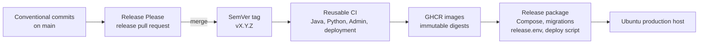

The release workflow:

1. checks out the tagged commit and verifies it belongs to `main`;
2. runs the reusable CI workflow;
3. builds API, Admin, and Executor images;
4. publishes version and source-SHA tags to GHCR;
5. records immutable image digests, SBOMs, and BuildKit provenance;
6. packages `docker-compose.prod.yml`, the deployment script, Supabase migrations,
   and `release.env`;
7. attaches the archive and SHA-256 checksum to the GitHub Release.

The production deployment script:

1. validates the environment, release metadata, image digest format, and disk
   space;
2. verifies Chrome and the relay;
3. backs up the existing PostgreSQL database;
4. pulls immutable images;
5. applies Supabase migrations when enabled;
6. runs Alembic before starting Executor processes;
7. starts API and Executor API and waits for readiness;
8. starts worker, Beat, and Admin;
9. waits for Admin health before updating the `current` symlink.

Flyway runs as part of API startup before API readiness succeeds.

### Backup and Recovery

Production PostgreSQL backups use a compressed custom-format dump, `rclone`
upload and remote-file verification. The supplied systemd timer installs this
outside application containers. Default retention is 7 local and 90 remote days.
Backups cover the shared API/Executor database, not remote Supabase or the host
Chrome profile. Backup and restoration procedures live in the
[operations guide](../deploy/PRODUCTION_COMMANDS.md).
`make restore-latest-prod-db` replaces local PostgreSQL data; it is destructive.

## Verification and Source Map

This architecture is based on source/configuration inspection, not a live
production audit. The owning READMEs describe setup and endpoint details:
[Admin](../savis-admin/README.md), [API](../savis-api/README.md),
[Executor](../savis-executor/README.md), [Supabase](../supabase/README.md).

| Concern                               | Source of truth                                                                                       |
| ------------------------------------- | ----------------------------------------------------------------------------------------------------- |
| Business modules and public contracts | `savis-api/src/main/java/com/savouretplus/savis/` and `*/api/package-info.java`                       |
| Module enforcement                    | `savis-api/src/test/java/com/savouretplus/savis/SavisApiModularityTests.java`                         |
| Provider execution and review         | `savis-executor/app/core/`, `app/adapters/` and `app/container.py`                                    |
| UI routes and backend clients         | `savis-admin/src/app/router/AppRouter.tsx`, `src/shared/api/index.ts`, `vite.config.ts`, `nginx.conf` |
| Persistence evolution                 | API Flyway, Executor Alembic and `supabase/migrations/`                                               |
| Local/production runtime              | `docker-compose.yml`, `docker-compose.prod.yml`, `Makefile`, Dockerfiles                              |
| Delivery and operations               | `.github/workflows/`, `deploy/`, `scripts/`, `test/smoke/`                                            |

CI runs Maven tests (including module verification), Admin lint/Vitest/build,
Executor locked install/Ruff/pytest/Alembic SQL-chain validation, container smoke
tests, production Compose validation and local Supabase migration lint. SQL RPC
behavior/concurrency scripts also exist under `supabase/tests/`; the current CI
workflow does not execute them as a separate test step.

For changes to behavior, run the owning application's checks documented in its
README. Cross-service changes require both sides' contract tests; smoke targets
exercise RabbitMQ/worker wiring, PostgreSQL migration startup and Nginx proxying.
A documentation-only change requires checking document structure, relative links
and statements against source rather than starting the runtime stack.

## Architectural Rules

1. Keep domain and core models independent from frameworks.
2. Keep cross-module Java dependencies behind named public APIs or ports.
3. Keep provider code behind Executor `OfferProvider` adapters.
4. Keep provider HTML, selectors, and parsing out of Java.
5. Keep the host browser lifecycle outside Celery and Docker.
6. Do not run more than one worker process against the shared Chrome profile.
7. Do not perform provider collection inside HTTP handlers or RabbitMQ
   callbacks.
8. Keep Java as owner of business state and Python as owner of acquisition
   state.
9. Keep schemas independently migrated and never let one service modify
   another service's tables.
10. Keep Catalog-to-BOM references as UUIDs and avoid JPA relationships across
    module boundaries.
11. Design message consumers for duplicate delivery.
12. Keep pricing recommendations advisory.
13. Keep Supabase as a public projection and raw submission inbox, not the
    source of normalized internal business truth.
14. Require health checks before promoting a production release.

## Known Constraints

- Maxi is currently the only configured provider adapter.
- The dashboard is static and is not an operational read model.
- RabbitMQ integration messages do not yet have a dead-letter queue.
- One shared browser profile limits scraping throughput.
- Chrome requires an active graphical Ubuntu session with `DISPLAY=:0` unless
  the installed user service is customized.
- Production deployment is automated by the packaged script, but the
  repository does not currently contain a dedicated deployment workflow.
- Bulk catalog publication does not currently remove projections for products
  that were changed from published to unpublished; use single-product removal
  to reconcile those projections.
- Public event quote requests have no import into internal commercial quotations.
- Failed order inbox rows require manual review and reset to `pending` before retry.
- Executor has no transactional result outbox; Supabase publication has no atomic
  local/remote commit or automatic reconciliation.
- Costs use current offers and rates, not persisted historical valuation snapshots.
- Inventory, purchase planning, payments, automatic taxes and credit notes are not
  implemented business slices.
