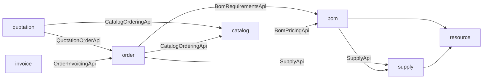
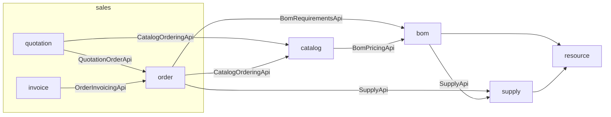

# Sales package refactoring

## Preliminary audit and decision

The POM pins Spring Modulith 2.1.0. The application uses default detection:
first-level packages below `SavisApiApplication` become modules. There is no
custom detection strategy, explicit entity scan, or repository scan. Before the
refactoring, `SavisApiModularityTests` verifies the complete model and generates
PlantUML documentation; both tests pass.

Cross-module production imports use public contracts:

| Consumer | Public provider contracts |
| --- | --- |
| quotation | catalog::catalog (`CatalogOrderingApi`), order::order (`QuotationOrderApi`), common::pdf |
| order | catalog::catalog (`CatalogOrderingApi`), bom::bom (`BomRequirementsApi`), supply::supply (`SupplyApi`, `OfferPricing`), common |
| invoice | order::order (`OrderInvoicingApi`, `InvoiceSourceOrderNotFoundException`), common::pdf |
| catalog | bom::bom (`BomPricingApi`), common |
| bom | supply::supply, resource::api, common |
| supply | resource::api, common |

`order.api` is already a named interface. Quotation and Invoice expose no
cross-module Java API. No consumer accesses another sales slice's repositories
or entities. Catalog has no dependency on any sales slice. Package references
are in Java source and tests (including one fully qualified MapStruct expression);
no legacy Java package references occur in runtime properties, JPA configuration,
or tracked documentation. JPA relationships and queries use entity names, while
Spring Boot scans the application root recursively. Historical migrations do not
need changes.

Options considered before moving packages:

1. Merely move packages: default detection would collapse the three slices into
   Sales, losing sibling boundary checks. Rejected.
2. Use native nested modules: explicitly annotate each child package with
   `@ApplicationModule`, retain default first-level detection and closed modules,
   and declare allowed dependencies through existing named interfaces. Selected.
3. Add a custom module-detection strategy or globally switch to explicit-only
   detection: unnecessary customization and risk to existing top-level modules.

[Spring Modulith nested modules](https://docs.spring.io/spring-modulith/reference/fundamentals.html#modules.nested)
are supported since 1.3. Nested modules may use their parent's internals and
public interfaces of siblings and top-level modules. Therefore Sales remains a
structural parent without workflow, entity, repository, or service code. External
modules must not consume Sales children directly. Catalog remains independent.
Explicit stable child identifiers `sales.quotation`, `sales.order`, and
`sales.invoice` make allowlists unambiguous. Existing named API contracts remain
unchanged apart from Order's Java package relocation.

## Module graphs

Arrows denote consumer → provider. Shared Common dependencies are omitted for
readability; Resource dependencies are retained.

Before:

After:

## Compatibility scope

Only Java package names and module metadata change. REST paths, JSON, pricing,
statuses, tables, Flyway migrations, PDF templates and fonts, Supabase adapters,
and Admin contracts retain their existing behavior. No dependency, table,
central Sales service, or Payment module is introduced.

## Validation

- Before moving packages: `./mvnw -Dtest=SavisApiModularityTests test` —
  2 tests passed.
- After relocation: `./mvnw clean -Dtest=SavisApiModularityTests test` —
  production/test compilation from a clean target and the original 2 tests passed.
- Extended architecture checks: `./mvnw -Dtest=SavisApiModularityTests test` —
  5 tests passed, including native nested-module detection, correct parentage,
  closed boundaries, Catalog independence, API exposure, and an isolated invalid
  fixture proving that sibling entity/repository access is rejected while the
  named public API is permitted.
- Complete backend suite: `./mvnw test` — 239 discovered, 222 passed,
  17 skipped, zero failures/errors. Includes Spring context and JPA persistence
  round trips for all Sales aggregates, Order/Invoice REST controller tests,
  idempotent quotation conversion, immutable order snapshots, invoice generation
  and concurrency, quotation/invoice PDF rendering, and Supabase adapters.
- All 121 relocated Java files match their original tracked content after only
  substituting the three package prefixes, including the MapStruct expression.
  No legacy package references remain in API source/configuration. Resources,
  migration SQL, dependencies, and Admin source are unchanged.
- `git diff --check` passed. No commit or deployment performed.

Residual validation limits: 13 BOM and 4 Supply PostgreSQL migration tests require
`BOM_MIGRATION_TEST_URL` and `SUPPLY_MIGRATION_TEST_URL`; these were absent, so
those pre-existing conditional tests were skipped. JPA was exercised on H2 in
PostgreSQL mode, not against a production PostgreSQL schema. No migration changed.
PDF renderer implementation, templates and fonts remain identical; renderer tests
passed, but no separate pixel comparison of historical production documents was
performed. Java consumers of the relocated Order API must use its new package;
HTTP/JSON consumers retain their contracts. Keep business implementation out of
the structural parent because native nested modules may access parent internals.

## SAVIS Admin directory alignment

Admin now groups its existing plural-named slices under
`src/features/sales/{quotations,orders,invoices}` and mirrors them under
`test/features/sales/`. The 33 source files and 15 test files retain their
implementations; only module paths and required import formatting change.
`SalesLayout` remains in `sales/pages/` and Catalog stays outside Sales.
Router imports and Vitest mocks use the new paths. Existing URLs, backend
requests, TanStack Query keys and browser draft-storage keys are preserved.
No central Sales service, new dependency or shared abstraction is introduced.

Admin validation: `npm test -- --run test/features/sales` passed all 31 tests
in 16 files; `npm test -- --run` passed all 255 tests in 56 files.
`npm run lint`, `npm run build`, and `git diff --check` passed. Existing Vite
configuration and bundle-size warnings remain informational.
